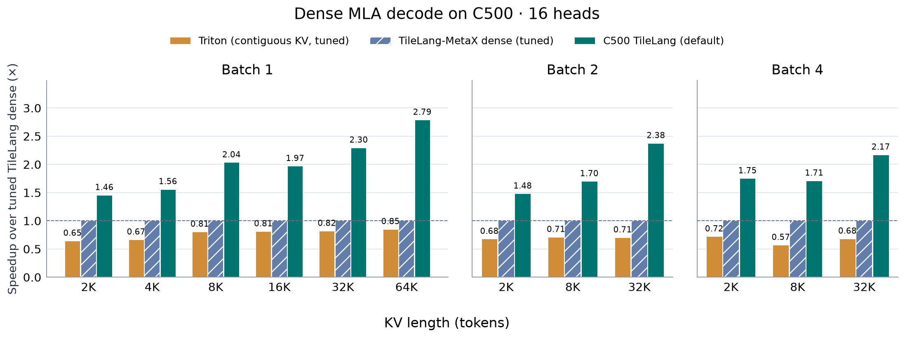
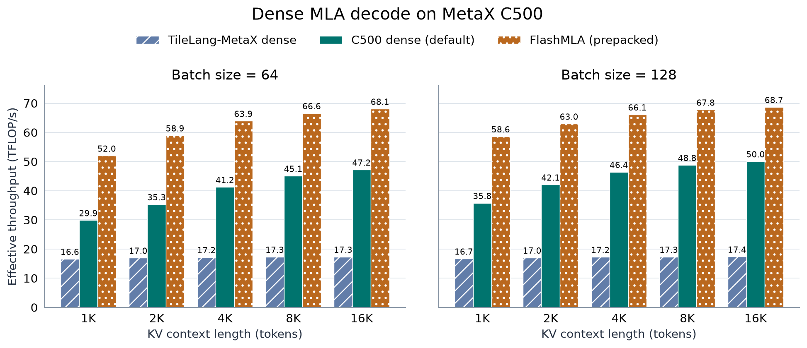

# Dense MLA decode on MetaX C500

This example implements single-token dense MLA with contiguous FP16 inputs, one KV head, 512 latent columns and 64 positional columns. Compile with `mla_decode_maca(batch, kv_length, query_heads=16)`, then pass Q, positional Q, KV, positional K and a preallocated output to the callable. Their shapes are `[B,H,512]`, `[B,H,64]`, `[B,N,1,512]`, `[B,N,1,64]` and `[B,H,512]`. Call `.contiguous()` after a device or layout conversion. On the tested MACA stack, a device conversion could leave KV with noncontiguous strides. H must be divisible by 16.

On a 50% MetaX C500 slice, the default kernel reduced full-call wall latency from **92.24 to 45.10 µs** at batch 1, 16 heads and 8K tokens, and from **33.64 to 11.67 ms** at batch 128, 128 heads and 16K tokens. Across the 22 workloads below, speedup over the tuned TileLang-MetaX dense example ranged from **1.43× to 2.88×**. The native paged FlashMLA call was faster on all ten large-batch workloads with a prepacked cache.

## C500 schedule

A block packs the latent and positional columns for one score GEMM. The value product and denominator reuse the same FP16 probability fragment. Partial tiles mask padded logits, and the FP32 split maxima, sums and numerators retain range during normalization.

The narrow schedule uses 16-head blocks and shared Q. The default split rule starts near 64 independent blocks on the measured C500 slice. Once a split would need more than eight key tiles, it targets four tiles per split. For wider schedules, Q uses a TileLang register fragment. A block can then reuse one shared KV tile across 32 or 64 heads. The default head tile depends on the number of independent head groups and key tiles. Near the crossover to 64-head blocks, the GPU has enough work for a smaller split count, which reduces partial-output writes and merge traffic. One split normalizes directly into the output. Multiple splits use a wave-level merge with an FP32 workspace of `4 * B * H * num_split * (512 + 2)` bytes. The optional `head_tile` and `num_split` arguments override the defaults. The benchmark screens candidate configurations and remeasures its shortlist before final timing.

The parameterized source targets lengths 1 through 65536. On a 50% C500 slice, full-output checks passed at batch 1 for lengths 1, 31, 32, 33, 2047, 2048, 2049, 6144, 8193, 12288, 65535 and 65536, and at batches 2 and 4 for lengths 33, 2049 and 8192. Each combination used eight random seeds, first- and last-token peaks and a large-value input, with FP32 reference tolerances of 0.002 (absolute and relative).

## Running the example

The [TileLang support matrix](https://github.com/tile-ai/tilelang/blob/4ed9b9edb5c9a1e05f52b3bd45e7116fea7ec9ab/README.md) lists MACA as an ecosystem backend. Run this example with a [TileLang-MetaX MACA build](https://github.com/tile-ai/tilelang-metax) and matching PyTorch-MACA. The tested stack used TileLang-MetaX `f549117c` and PyTorch `2.8.0+metax3.7.1.3`. With a source build, set `PYTHONPATH` to that backend checkout and expose the MACA SDK as in its installation guide. Set `TILELANG_METAX_ROOT` to the baseline source checkout for the paired comparison. From this directory, check an uneven length against the FP32 reference.

```bash
python benchmark_mla_decode_maca.py --kv-length 2049 --batch-size 2 --check-only
```

For an aligned comparison, point the harness at the reference checkout. The split baseline requires whole 32-token tiles per split. The harness checks random inputs, first- and last-token peaks and large values before measuring complete calls in alternating order with device events and host wall time.

```bash
python benchmark_mla_decode_maca.py --kv-length 8192 --baseline-splits 128 --seeds 100 \
  --baseline-file "$TILELANG_METAX_ROOT/examples/deepseek_mla/example_mla_decode.py"
```

## Small-batch full-call latency

These are medians for the default factory on a 50% C500 slice (32000 MiB), compared with the [TileLang-MetaX dense example](https://github.com/tile-ai/tilelang-metax/blob/90d49f353ec88bd0d346474f143003d865dd3b79/examples/deepseek_mla/example_mla_decode.py). H=16. The baseline uses a 32-key, 16-head tile and its best measured power-of-two split count. Six alternating batches used 200 warmups and 2000 measured calls each, including output allocation and all launches.



Each marker is a measured shape. Speedup is the median baseline wall time divided by the median C500 wall time.

| Batch | KV | C500 splits | Baseline splits | C500 wall (µs) | Baseline wall (µs) | Speedup |
|---:|---:|---:|---:|---:|---:|---:|
| 1 | 2048 | 64 | 64 | 25.01 | 35.84 | 1.43× |
| 1 | 4096 | 64 | 64 | 31.42 | 48.12 | 1.53× |
| 1 | 8192 | 64 | 128 | 45.10 | 92.24 | 2.05× |
| 1 | 16384 | 64 | 256 | 78.75 | 157.47 | 2.00× |
| 1 | 32768 | 256 | 512 | 123.80 | 284.62 | 2.30× |
| 1 | 65536 | 512 | 1024 | 201.91 | 563.88 | 2.79× |
| 2 | 2048 | 32 | 32 | 30.00 | 44.42 | 1.48× |
| 2 | 8192 | 32 | 128 | 77.79 | 131.23 | 1.69× |
| 2 | 32768 | 256 | 512 | 188.08 | 441.83 | 2.35× |
| 4 | 2048 | 16 | 32 | 42.75 | 74.00 | 1.73× |
| 4 | 8192 | 64 | 128 | 112.94 | 192.74 | 1.71× |
| 4 | 32768 | 256 | 512 | 339.61 | 739.37 | 2.18× |

## Large-batch decode with 128 heads

The following C500 cases use the nominal batch, head count and lengths from the [AMD example](../amd), with uniform lengths and dense FP16 inputs. The AMD AITER benchmark driver uses BF16 and varies lengths within each batch. All figures in this table were measured on C500. For the dense baseline we screened power-of-two splits at head tile 16 and key tile 32. We then checked feasible head tiles 16/32/64 and key tiles 16/32 with splits 1, 4, 8 and the earlier winner. The fastest measured dense configuration for these ten rows was head tile 16, key tile 32 and one split. The optional FlashMLA column times its native paged call with Q, KV, identity page tables and scheduler metadata prepared in advance. The call also produces LSE. Measurements used six interleaved batches with five warmups and 30 measured calls each.



Effective TFLOP/s counts the score and value products as `2 × B × H × N × (576 + 512)` operations, following the AMD TileLang example. Each bar divides that count by the median full-call wall time. Packing and scheduling metadata for the native paged series are prepared beforehand.

| Batch | KV | Default head tile / splits | C500 wall (µs) | Dense baseline wall (µs) | Dense speedup | Native paged FlashMLA wall (µs) |
|---:|---:|---:|---:|---:|---:|---:|
| 64 | 1024 | 64 / 2 | 610.99 | 1098.53 | 1.80× | 351.08 |
| 64 | 2048 | 64 / 4 | 1033.73 | 2150.67 | 2.08× | 619.41 |
| 64 | 4096 | 64 / 4 | 1771.24 | 4248.83 | 2.40× | 1142.32 |
| 64 | 8192 | 64 / 4 | 3240.63 | 8436.91 | 2.60× | 2193.86 |
| 64 | 16384 | 64 / 4 | 6187.32 | 16849.09 | 2.72× | 4290.76 |
| 128 | 1024 | 64 / 1 | 1020.29 | 2187.06 | 2.14× | 622.93 |
| 128 | 2048 | 64 / 2 | 1735.53 | 4285.20 | 2.47× | 1159.60 |
| 128 | 4096 | 64 / 2 | 3144.87 | 8474.82 | 2.69× | 2208.98 |
| 128 | 8192 | 64 / 2 | 5985.78 | 16862.73 | 2.82× | 4309.13 |
| 128 | 16384 | 64 / 2 | 11671.82 | 33638.07 | 2.88× | 8504.45 |

To run both comparisons on a MACA environment with FlashMLA installed, add `--native-flashmla`. The CLI pairs the candidate with each baseline separately.

```bash
python benchmark_mla_decode_maca.py --batch-size 64 --heads 128 --kv-length 1024 \
  --baseline-file "$TILELANG_METAX_ROOT/examples/deepseek_mla/example_mla_decode.py" \
  --baseline-splits 1 --native-flashmla --warmup 5 --iterations 30
```

Use `--tune` to compare head tiles and power-of-two split counts, or `--tune-splits` to keep the head tile fixed. Screening uses independent inputs and limits the searched FP32 partial workspace to 3 GiB. The JSON output includes the selected configuration, screening samples, full-output error, and event and wall timings.
